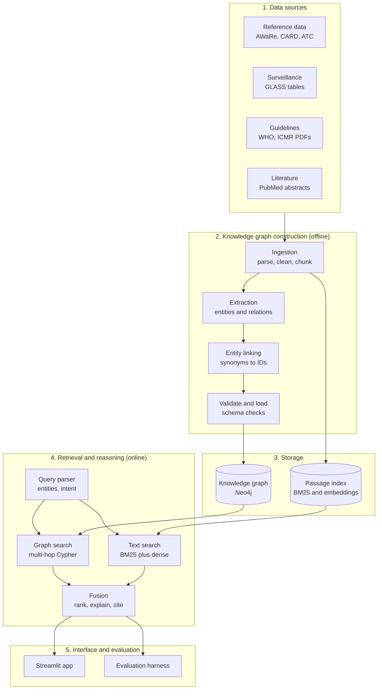
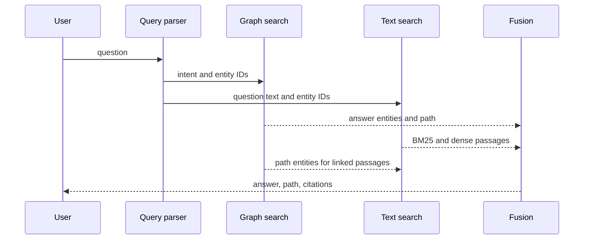

# AMR-Navigator: Architecture

AMR-Navigator is a knowledge graph and hybrid retrieval system that explains why an antibiotic is recommended or restricted for a resistant pathogen. It is a mini-project for the Knowledge Graph and Information Retrieval Systems (KGIRS) course.

> **Not medical advice.** The system is an educational tool. It does not replace susceptibility testing, local antibiograms or clinical judgement.

Related documents: [DECISIONS.md](DECISIONS.md) records why the design is this way, and [PLAN.md](PLAN.md) records the build order.

## 1. Overview

The system has two paths that share one store:

- **Offline build path** (layers 1–3): turn source documents into a knowledge graph and a passage index.
- **Online query path** (layers 3–5): turn a question into an answer, a reasoning path and citations.



## 2. Scope

| Item | Target |
|---|---|
| Pathogens | 5: *Klebsiella pneumoniae*, *Escherichia coli*, *Acinetobacter baumannii*, *Pseudomonas aeruginosa*, *Staphylococcus aureus* |
| Resistance mechanisms | about 10 (KPC, NDM, OXA-48, VIM, CTX-M/ESBL, AmpC, mecA/MRSA and others) |
| Drugs | about 50, in about 15 classes |
| Recommendations | 40–80, from the WHO AWaRe antibiotic book and ICMR guidelines |
| Abstracts | 300–500 from PubMed |
| Graph size | roughly 1–3k nodes, 5–10k edges |

## 3. Layer 1: data sources

| Source | Format | What it gives | Loaded as |
|---|---|---|---|
| WHO AWaRe classification | Excel | Drug list, class, Access / Watch / Reserve group | `Drug`, `DrugClass`, `IN_CLASS` |
| CARD (Comprehensive Antibiotic Resistance Database) | TSV / JSON | Resistance genes, mechanisms, affected drug classes | `Gene`, `Mechanism`, `ENCODES`, `CONFERS_RESISTANCE_TO` |
| WHO ATC index | Table | ATC code per drug | `Drug.id` |
| ChEBI / RxNorm | Table | Drug synonyms and brand names | `Drug.synonyms` |
| NCBI Taxonomy | Table | Pathogen names and IDs | `Pathogen` |
| WHO GLASS | CSV | Resistance % by country, year, pathogen, drug | `SurveillanceStat` |
| WHO AWaRe antibiotic book, ICMR guidelines | PDF | Treatment recommendations | `Recommendation`, `Guideline`, passages |
| PubMed | Abstract text | Supporting literature | passages, `MENTIONS` |

Structured sources supply the core of the graph. Text sources supply recommendations, passages and mentions.

## 4. Layer 2: knowledge graph construction

Each stage reads files and writes files, so any stage can be re-run on its own.

| Stage | Input | What it does | Output |
|---|---|---|---|
| **Ingestion** (`pipeline/ingest.py`) | `data/raw/` | Reads tables with `pandas`. Reads PDFs with `pdfplumber`. Fetches abstracts by PMID through PubMed E-utilities. Splits text into section-aware passages of 150–250 words. | `nodes_*.csv`, `edges_*.csv`, `passages.jsonl` |
| **Extraction** (`pipeline/extract.py`) | `passages.jsonl` | Finds entity mentions with a dictionary matcher (spaCy `PhraseMatcher`). Extracts recommendations into a fixed Pydantic model, using rule patterns and, optionally, an LLM with structured output. | `mentions.jsonl`, `recommendations_extracted.jsonl` |
| **Entity linking** (`pipeline/link.py`) | mentions, synonym dictionary | Maps each mention to one canonical ID: exact match first, then normalised match, then fuzzy match (`rapidfuzz`) above a threshold. Unlinked mentions go to a review file. | `mentions_linked.jsonl`, `unlinked.csv` |
| **Validate and load** (`pipeline/load.py`) | all processed files | Checks every node and edge against the schema, drops duplicates, then loads into Neo4j with batched `MERGE`. | Neo4j graph, `load_report.json` |

A hand-curated file, `recommendations_curated.csv`, is loaded alongside the extracted recommendations. It is the gold standard for evaluating extraction and the guaranteed source of recommendation data.

### Canonical IDs

| Entity | ID |
|---|---|
| `Drug` | ATC code, e.g. `J01DH02` for meropenem |
| `DrugClass` | slug, e.g. `carbapenem` |
| `Pathogen` | NCBI taxonomy ID, e.g. `NCBITaxon:573` |
| `Gene`, `Mechanism` | CARD ARO accession, e.g. `ARO:3000059` |
| `Guideline` | slug with year, e.g. `who-aware-book-2022` |
| `Passage` | `<source>:<section>:<n>` |

The exact formats, including IDs for entities with no public identifier, are in [CONTRACTS.md](CONTRACTS.md) section 2.

## 5. Layer 3: storage

### 5.1 Graph schema (Neo4j, labelled property graph)

**Nodes**

| Label | Key | Other properties |
|---|---|---|
| `Pathogen` | `id` | `name`, `gram_stain`, `synonyms` |
| `Mechanism` | `id` | `name`, `type` (e.g. carbapenemase), `ambler_class` |
| `Gene` | `id` | `name` |
| `Drug` | `id` | `name`, `aware_group`, `synonyms` |
| `DrugClass` | `id` | `name` |
| `Recommendation` | `id` | `infection_site`, `line_of_therapy`, `patient_group`, `text` |
| `Guideline` | `id` | `title`, `organisation`, `year`, `version` |
| `SurveillanceStat` | `id` | `country`, `year`, `pct_resistant`, `n_tested` |
| `Passage` | `id` | `text`, `source_doc`, `section` |

**Relationships**

```cypher
(Pathogen)-[:HAS_MECHANISM]->(Mechanism)
(Gene)-[:ENCODES]->(Mechanism)
(Mechanism)-[:CONFERS_RESISTANCE_TO]->(DrugClass)
(Mechanism)-[:INACTIVATES]->(Drug)                 // drug-level exceptions
(Pathogen)-[:INTRINSICALLY_RESISTANT_TO]->(DrugClass)
(Drug)-[:IN_CLASS]->(DrugClass)
(Recommendation)-[:FOR_PATHOGEN]->(Pathogen)
(Recommendation)-[:FOR_MECHANISM]->(Mechanism)     // only when the guideline names one
(Recommendation)-[:RECOMMENDS]->(Drug)
(Recommendation)-[:FROM]->(Guideline)
(SurveillanceStat)-[:ABOUT_PATHOGEN]->(Pathogen)
(SurveillanceStat)-[:ABOUT_DRUG]->(Drug)
(SurveillanceStat)-[:ABOUT_CLASS]->(DrugClass)    // when GLASS reports a class, not a drug
(Passage)-[:MENTIONS]->(Pathogen|Drug|DrugClass|Mechanism)
(Passage)-[:SUPPORTS]->(Recommendation)
```

**Properties on every relationship**

| Property | Meaning |
|---|---|
| `source_id` | Dataset or document the edge came from |
| `method` | `curated`, `rule` or `llm` |
| `confidence` | 1.0 for curated edges, a score for extracted edges |
| `evidence_passage_id` | Passage that supports the edge, when there is one |

**Constraints**

```cypher
CREATE CONSTRAINT FOR (n:Pathogen)       REQUIRE n.id IS UNIQUE;
CREATE CONSTRAINT FOR (n:Mechanism)      REQUIRE n.id IS UNIQUE;
CREATE CONSTRAINT FOR (n:Gene)           REQUIRE n.id IS UNIQUE;
CREATE CONSTRAINT FOR (n:Drug)           REQUIRE n.id IS UNIQUE;
CREATE CONSTRAINT FOR (n:DrugClass)      REQUIRE n.id IS UNIQUE;
CREATE CONSTRAINT FOR (n:Recommendation) REQUIRE n.id IS UNIQUE;
CREATE CONSTRAINT FOR (n:Guideline)      REQUIRE n.id IS UNIQUE;
CREATE CONSTRAINT FOR (n:Passage)        REQUIRE n.id IS UNIQUE;
```

Required properties are checked in Python before loading, because property-existence constraints are not available in Neo4j Community Edition.

### 5.2 Modelling rules

1. **Mechanisms are explicit.** "Carbapenem resistance" is never a direct pathogen-to-class edge. It always goes through a `Mechanism`, because the alternatives depend on which mechanism is present.
2. **Recommendations are nodes.** A recommendation carries infection site, line of therapy and patient group, which an edge between drug and guideline cannot hold.
3. **Combination drugs get their own class.** β-lactam/β-lactamase-inhibitor combinations such as ceftazidime-avibactam are placed in a separate class, not in "third-generation cephalosporins". Otherwise a class-level resistance edge would wrongly exclude them.
4. **Drug-level exceptions use `INACTIVATES`.** For example, NDM inactivates ceftazidime-avibactam even though its class is otherwise active.

### 5.3 Passage index

- **Sparse:** `rank_bm25` over tokenised passages.
- **Dense:** `sentence-transformers` embeddings in a FAISS HNSW index.
- Both indexes use the same passage IDs as the `Passage` nodes, so any retrieved passage can be joined back to the graph through `MENTIONS`.

## 6. Layer 4: retrieval and reasoning

### 6.1 Query parser

1. Run the same entity linker used at build time on the question.
2. Classify the question into an intent, using the types of the linked entities and trigger words.
3. If no intent matches, fall back to text search only.

| Intent | Example | Entities needed |
|---|---|---|
| `alternatives` | "If carbapenem resistance is reported for Klebsiella, which alternatives remain?" | Pathogen, DrugClass |
| `why_restricted` | "Why is colistin restricted?" | Drug |
| `mechanism_lookup` | "How does *E. coli* resist cephalosporins?" | Pathogen, DrugClass |
| `recommendation_lookup` | "What is recommended for MRSA bloodstream infection?" | Pathogen, optional site |
| `drug_profile` | "What class and AWaRe group is meropenem?" | Drug |
| `surveillance` | "How common is carbapenem resistance in Klebsiella in India?" | Pathogen, Drug or DrugClass, country |

### 6.2 Graph search

One parameterised Cypher template per intent. The `alternatives` template:

```cypher
MATCH (p:Pathogen {id: $pathogen_id})-[:HAS_MECHANISM]->(m:Mechanism)
      -[:CONFERS_RESISTANCE_TO]->(:DrugClass {id: $class_id})
MATCH (r:Recommendation)-[:FOR_PATHOGEN]->(p)
MATCH (r)-[:RECOMMENDS]->(d:Drug)-[:IN_CLASS]->(c:DrugClass)
MATCH (r)-[:FROM]->(g:Guideline)
WHERE NOT (m)-[:CONFERS_RESISTANCE_TO]->(c)
  AND NOT (m)-[:INACTIVATES]->(d)
  AND NOT (p)-[:INTRINSICALLY_RESISTANT_TO]->(c)
  AND (NOT (r)-[:FOR_MECHANISM]->(:Mechanism) OR (r)-[:FOR_MECHANISM]->(m))
RETURN m.name AS mechanism, d.name AS drug, d.aware_group AS aware_group,
       r.infection_site AS site, r.line_of_therapy AS line,
       g.title AS guideline, g.year AS year, r.id AS recommendation_id
ORDER BY mechanism, line
```

The result is grouped by mechanism, so the answer for KPC differs from the answer for NDM.

Each template also returns the IDs of the nodes and relationships it traversed. These form the reasoning path shown to the user.

### 6.3 Text search

- BM25 top-k and dense top-k over all passages.
- A third list, **graph-linked passages**: passages that `MENTION` entities on the reasoning path or `SUPPORT` a returned recommendation.

### 6.4 Fusion

- The three passage lists are merged with reciprocal rank fusion: `score(p) = Σ 1 / (60 + rank_i(p))`.
- Answer entities (for example, alternative drugs) are ranked by path validity first, then by the number of supporting passages.

### 6.5 Answer and explanation

The answer is built from a template, not free generation:

- the answer entities, grouped as the intent requires;
- the reasoning path, e.g. `K. pneumoniae → NDM → carbapenem (resistant) → aztreonam-avibactam (not inactivated) → guideline`;
- the top supporting passages with their source and section;
- the provenance of each edge on the path (`source_id`, `method`).



## 7. Layer 5: interface and evaluation

### 7.1 Streamlit app

- Question box with example questions.
- Answer panel grouped by mechanism, with AWaRe group shown per drug.
- Reasoning path drawn as a small graph (`pyvis`).
- Supporting passages with source links.
- Retrieval mode switch: BM25, dense, graph only, hybrid.
- Permanent "not medical advice" banner.

### 7.2 Evaluation harness

`eval/run_eval.py` runs every test question through each retrieval mode and writes one results table.

| What is measured | Metric | Data |
|---|---|---|
| Passage retrieval | Recall@k, MRR, nDCG@k | 40 questions with relevant passages marked |
| Answer correctness | Precision, recall, F1 on the answer set | Same 40 questions with gold answers |
| Multi-hop questions | Same metrics, reported separately | 20 of the 40 questions |
| Entity linking | Accuracy | about 100 labelled mentions |
| Relation extraction | Precision, recall, F1 | Extracted vs. curated recommendations |

Systems compared: BM25, dense, BM25 + dense, graph only, graph + text hybrid.

## 8. Technology stack

| Purpose | Choice |
|---|---|
| Language | Python 3.11 |
| Graph database | Neo4j 5 Community in Docker (`docker-compose.yml`), official `neo4j` driver |
| Tables and PDFs | `pandas`, `pdfplumber` |
| Entity matching | spaCy `PhraseMatcher`, `rapidfuzz` |
| Schema validation | `pydantic` |
| Sparse retrieval | `rank_bm25` |
| Dense retrieval | `sentence-transformers`, `faiss-cpu` |
| Interface | `streamlit`, `pyvis` |
| Evaluation | plain Python, optional `ragas` |

## 9. Folder structure

```
KGIRS-Micro/
├── docs/            ARCHITECTURE, DECISIONS, PLAN, CONTRACTS, ORCHESTRATION
│   ├── tasks/       one brief per task
│   └── handoffs/    one report per finished task
├── data/
│   ├── raw/         downloaded sources (not committed)
│   ├── curated/     hand-written resistance facts and recommendations
│   └── processed/   nodes, edges, passages, mentions
├── schema/          constraints.cypher, scope, synonym dictionary, class overrides
├── pipeline/        config.py, models.py, validate.py, graph_db.py, download.py,
│                    ingest.py, extract.py, link.py, load.py
├── tests/           pytest tests
├── retrieval/       parser.py, graph_search.py, text_search.py, fusion.py, answer.py
├── app/             streamlit_app.py
├── eval/            questions.json, labelled sets, run_eval.py, results/
└── report/          figures and final report
```

## 10. Syllabus coverage

| Syllabus topic | Where it appears |
|---|---|
| Sparse vs dense retrieval, BM25 (1.3, 2.1) | Text search, baselines |
| ANN indexing, hybrid search, metadata filtering (2.2) | FAISS HNSW, fusion, entity-filtered passages |
| Triples, labelled property graph, schema design (3.1, 3.2) | Graph schema and modelling rules |
| Graph databases, traversal, pattern matching (4.1, 4.2) | Neo4j, multi-hop Cypher templates |
| Entity resolution, schema-guided extraction (4.2) | Entity linking, Pydantic recommendation model |
| Document understanding (4.3) | PDF ingestion |
| Chunking (5.1) | Section-aware passages |
| GraphRAG, reasoning paths (6.1) | Graph search plus graph-linked passages |
| NDCG, Recall@K, MRR (6.2) | Evaluation harness |
| Explainability (6.3) | Reasoning path and edge provenance |

## 11. Known limitations

- Guidelines change; each `Guideline` node stores year and version, and answers show them.
- GLASS data is national and aggregated. It does not reflect a specific hospital.
- Resistance in a real isolate can involve several mechanisms at once. The graph reasons about one mechanism at a time.
- Coverage is limited to the five pathogens in scope.
